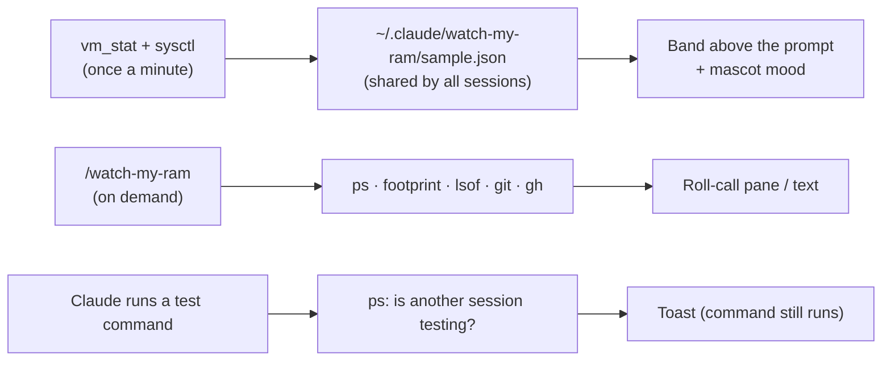

<div align="center">

&nbsp;&nbsp;&nbsp;&nbsp;&nbsp;&nbsp;

# watch-my-ram

**A tiny RAM stick that sweats, so your Mac doesn't have to.**

A Claude Code mod for macOS. It notices when your Mac runs low on memory, and shows which sessions and processes are holding it.


</div>

## Why this exists

AI coding agents start dev servers, test runners and browsers, and often leave them behind: sessions stay open after their PR merges, several worktrees run tests at once, and processes outlive the agent that started them. On a 16 GB Mac that adds up to tens of GB of swap, heat and lag.

watch-my-ram shows how much memory is in use and which sessions and processes hold it, so you know what to close. **You** decide what to close; the mod never does.

## Install

At the prompt of a Claude Code terminal session:

```
/plugin install watch-my-ram --marketplace nguyenphusi/watch-my-ram
```

Answer `y` to add the marketplace, then pick the **user** scope so every session loads the mod. In the Claude Desktop app, click **+** next to the prompt box → **Plugins** → **Add marketplace** with `nguyenphusi/watch-my-ram` → **Add plugin**. More options are in [Install details](#install-details).

**Requirements:**
- macOS (the mod reads `vm_stat`, `sysctl`, `footprint` and `lsof`).
- Claude Code 2.1.287 or later, which runs mods (tested on 2.1.318).
- Optional: the GitHub CLI `gh`, signed in, to fill the PR column of `/watch-my-ram`.

## What you get

**A band above the prompt.** Memory in use, RAM + swap, and macOS memory pressure. The mascot floats at *normal*, sweats at *warning*, and panics at *critical*.


**`/watch-my-ram` roll-call.** Every live Claude session with its RAM, folder, age and whether its PR is merged, plus orphan dev processes and open dev ports. One button asks Claude what to close, as advice only.


**Parallel test warning.** A toast when Claude starts tests while another session is already running them. Your command still runs.


The mascot's three moods:

| normal | warning | critical |
|:-:|:-:|:-:|
|  |  |  |
| `(•‿•)` floats and blinks | `(°_°;)` sweats | `(ﾟДﾟ)` shakes and steams |

Claude Desktop and VS Code draw the animated picture; a terminal draws the text face.

## Is it safe?

Yes. watch-my-ram **only reads and warns**.

- **It never** kills or closes a process or session, blocks or changes a command you or Claude run, or prints another process's command-line arguments.
- **It writes one file:** `~/.claude/watch-my-ram/sample.json`, holding four numbers and the pressure level.
- **Every command it runs is read-only:** `vm_stat`, `sysctl`, `ps`, `lsof`, `footprint`, `git rev-parse` / `git branch --show-current`, and `gh pr list` / `gh pr view`. You can check this in [`hooks/register.tsx`](hooks/register.tsx).
- **Network:** the mod itself only calls `gh`, using your own sign-in, to read PR states, and only when the roll-call is fetched.
- **What reaches Claude, and only when you choose:** pressing "Ask Claude for suggestions", or sending the terminal suggestion, sends the roll-call on screen to Claude as a normal chat message: session folders, PIDs, RAM figures, ports and PR states. Claude is told not to run, stop, close, kill or delete anything. Anything you then ask Claude to do still goes through the normal permission prompts.
- **Cheap to run:** even with 20 sessions open, the Mac measures memory about once a minute (see below).

## How it works

<details>
<summary><b>Under the hood, in 30 seconds</b></summary>



1. **Measure.** One shell runs `vm_stat` (RAM pages), `sysctl vm.swapusage hw.memsize` (swap and installed RAM) and `sysctl kern.memorystatus_vm_pressure_level` (macOS memory pressure).
2. **Share.** The result goes into one cache file. A session reads it if it is under 30 seconds old and measures again only if it is stale. So 20 sessions still cost about one measurement a minute.
3. **Judge by pressure, not GB.** Swap that sits idle on disk costs nothing, and macOS is slow to give it back, so a GB total can stay high while the Mac feels fine. Pressure is macOS's own judgement, the same level as Activity Monitor's Memory Pressure graph.
4. **Roll-call on demand.** `ps` finds the Claude sessions and orphan dev processes, `footprint` gives the same RAM figure as Activity Monitor, `lsof` finds folders and listening ports, and `gh pr list` (one call per repository, cached for 10 minutes) marks merged PRs.
5. **Test warning.** Only when a Bash command looks like a test command does the mod run `ps` to look for vitest or playwright in another session.

</details>

<details>
<summary><b>The band in detail</b></summary>

```
watch-my-ram · 22.2 GB in use · RAM 12.5/16 + swap 9.7 · pressure warning
```

This reads as follows. 22.2 GB of memory is in use: 12.5 GB in physical RAM (the Mac has 16 GB) and 9.7 GB in swap. The colour follows **macOS memory pressure**: dim at *normal*, yellow at *warning*, red at *critical*.

If you set a GB threshold yourself (see [Change the threshold](#change-the-threshold)), that threshold decides instead: the band reads `alert >24` and turns red above 24 GB, whatever the pressure. On a Mac that does not report a pressure level, the band falls back to the automatic GB threshold, 1.25 × installed RAM (`alert >20 (auto)` on 16 GB).

The band is kept short (about 75 characters) so Claude Code's own text does not draw over it. The pane and the `/watch-my-ram` command use the full sentence: `22.2 GB in use (RAM 12.5 of 16 GB + swap 9.7 GB) · macOS memory pressure warning · WARNING`.

*Memory in use* is RAM in use plus swap used:
- RAM in use: the active, wired and "occupied by compressor" pages from `vm_stat`, times the page size.
- Swap used: from `sysctl vm.swapusage`.
- Installed RAM: from `sysctl hw.memsize`, read in the same run.
- Pressure level: from `sysctl kern.memorystatus_vm_pressure_level` (1 normal, 2 warning, 4 critical), read in the same run.
- Units: 1 GB = 1024³ bytes.

The band measures once every 60 seconds, and all sessions share one cache file, `~/.claude/watch-my-ram/sample.json`. If the file is fresh (under 30 seconds old), a session reads it. If it is old, missing or broken, that session measures and writes it again.

To hide the band in one session only: in a terminal, press `[-]` at the end of the band (or ctrl+x ctrl+a); in Claude Desktop, press **Hide** at the end of the band. Running `/watch-my-ram` shows it again.

</details>

<details>
<summary><b>The <code>/watch-my-ram</code> roll-call in detail</b></summary>

The command answers at once, without a Claude turn. Where you see the answer depends on where you run it:

- **In a terminal**, the roll-call is printed in the chat. Claude can read it too, and the prompt box then offers a dim suggestion, *"Suggest what I could clean up from the watch-my-ram roll-call above. Advice only: …"*. Press Tab to take it, then Enter to send.
- **In Claude Desktop (and VS Code)**, it opens a **pane** named `watch-my-ram` with three buttons on its first row:
  - **Refresh** fetches the tables again.
  - **Ask Claude for suggestions** sends Claude the roll-call on screen and asks what you could close to free memory, biggest win first.
  - **Close** closes the pane (Esc does too, once the pane has the focus).
- **Headless:** `claude -p "/watch-my-ram"` prints the same roll-call as text.

What it shows:
- A memory line, which follows the 60-second sample.
- The live Claude sessions, numbered from 1: pid, folder or worktree, age, RAM, and whether the PR is MERGED. Sessions with a merged PR are drawn in a different colour, and the current session is bold and marked `(this session)`.
- Orphan dev processes, meaning processes with PPID 1: node, tsx, vite, vitest, playwright and headless chromium.
- Dev ports in LISTEN. A port counts as a dev port only when its process runs under a Claude session or inside a project folder (not `/`, `~`, `/Applications`, `~/Library` …).

Details:
- **The RAM column** is the memory footprint, the same figure as the MEM column of top and Activity Monitor, which counts compressed and swapped-out pages too. A value marked `*` is RSS, used when the footprint cannot be read.
- **When the tables are fetched:** only when you run the command, when Refresh is pressed, and automatically at most once every 5 minutes while the pane is open. `ps`, `footprint`, `lsof`, `git` and `gh` never run in the 60-second loop.
- **PR state** is fetched in a batch: one `gh pr list` per repository (worktrees of the same repository share it), matched by branch name and remembered for 10 minutes. The session table shows at once (about 1 second); the PR column shows `…` and fills in when `gh` answers.
- **Layout:** the pane asks for a tall area, and what does not fit scrolls. The orphan-process and dev-port summary sits above the session table, so it is always visible.

</details>

<details>
<summary><b>The parallel test warning in detail</b></summary>

When Claude is about to run a test command (`vitest`, `npx vitest`, `playwright test`, `pnpm test*`, `pnpm -r test`, `npm run test*`, `yarn test` …) while another session is running vitest or playwright, the mod shows a toast naming that session's folder. Your command **still runs unchanged**. At most 1 toast every 5 minutes per session. `ps` runs only when the command matches a test command.

</details>

## Install details

From a shell:

```sh
claude plugin install watch-my-ram --marketplace nguyenphusi/watch-my-ram
```

The install may end with a note like `1 userConfig option not yet set`. That is expected, not an error: the one option is the GB alert threshold, and leaving it unset means the band follows macOS memory pressure.

Installed at user scope, the mod loads in every `claude` session started afterwards: terminal sessions, sessions inside other tools' terminals, and the local session Claude Desktop runs for its Code tab, where the band is drawn too. In a session that is already open, type `/reload-plugins` or restart it.

To update, refresh the marketplace and then the plugin, and restart open sessions (or run `/reload-plugins` in them):

```sh
claude plugin marketplace update watch-my-ram
claude plugin update watch-my-ram@watch-my-ram
```

## Change the threshold

By default there is no GB threshold: the band follows macOS memory pressure (yellow at warning, red at critical). Only on a Mac that reports no pressure level does it fall back to an automatic GB threshold, 1.25 × installed RAM (20 GB on a 16 GB Mac, 10 GB on an 8 GB Mac).

To alert on a fixed amount of RAM + swap instead, set a number of GB. The band then turns red above it and ignores pressure:

- In a session: open `/config`, find the row **watch-my-ram › Memory alert threshold (GB)**, and enter a number of GB. The mod reloads with the new threshold, and the band changes on its next draw. Enter `0` to go back to following memory pressure.
- From a shell: `echo '{"threshold_gb":"24"}' | claude plugin configure watch-my-ram@watch-my-ram --values-stdin`. To go back to following memory pressure: `echo '{"threshold_gb":"0"}' | claude plugin configure watch-my-ram@watch-my-ram --values-stdin` (an empty value `""` is treated as "no change").

## Disable / uninstall

```sh
claude plugin disable watch-my-ram@watch-my-ram     # turn off, keep it installed
claude plugin enable watch-my-ram@watch-my-ram      # turn back on
claude plugin uninstall watch-my-ram@watch-my-ram   # remove it completely
claude plugin marketplace remove watch-my-ram       # then forget the marketplace
rm -r ~/.claude/watch-my-ram                        # optional: the shared memory sample
```

## Development

```sh
claude plugin validate . --profile directory --strict
claude plugin test .
node scripts/export-mascot-svgs.mts --check
npx -p typescript tsc --noEmit -p .   # type check, see below
claude --plugin-dir .    # a test session that loads the mod from this folder
```

CI runs the first three on every pull request, every push to `main` and once a week, against the latest Claude Code. The type check runs only locally: it needs the type files that Claude Code writes to `.claude-plugin/types/` when a signed-in session loads the mod, so start `claude --plugin-dir .` once first. See [CONTRIBUTING.md](CONTRIBUTING.md) to send a change.

Pure logic lives in `hooks/lib/` (with unit tests in `tests/`); `hooks/register.tsx` only wires the hooks together. The mascot SVGs in `assets/` are generated from `hooks/lib/mascot.ts`: after changing the mascot, run `node scripts/export-mascot-svgs.mts` (Node 23.6+) and commit the new SVGs. The plugin icon `.claude-plugin/icon.png` is a 512 px render of `assets/mascot-normal.svg`.

Screenshots are real captures of version 0.3.0 on macOS, with project paths redacted, hosted as [GitHub release attachments](https://github.com/nguyenphusi/watch-my-ram/releases/tag/readme-assets-2026-11-05) outside Git history. Keep those assets available when updating this README.

## License

[MIT](LICENSE)
